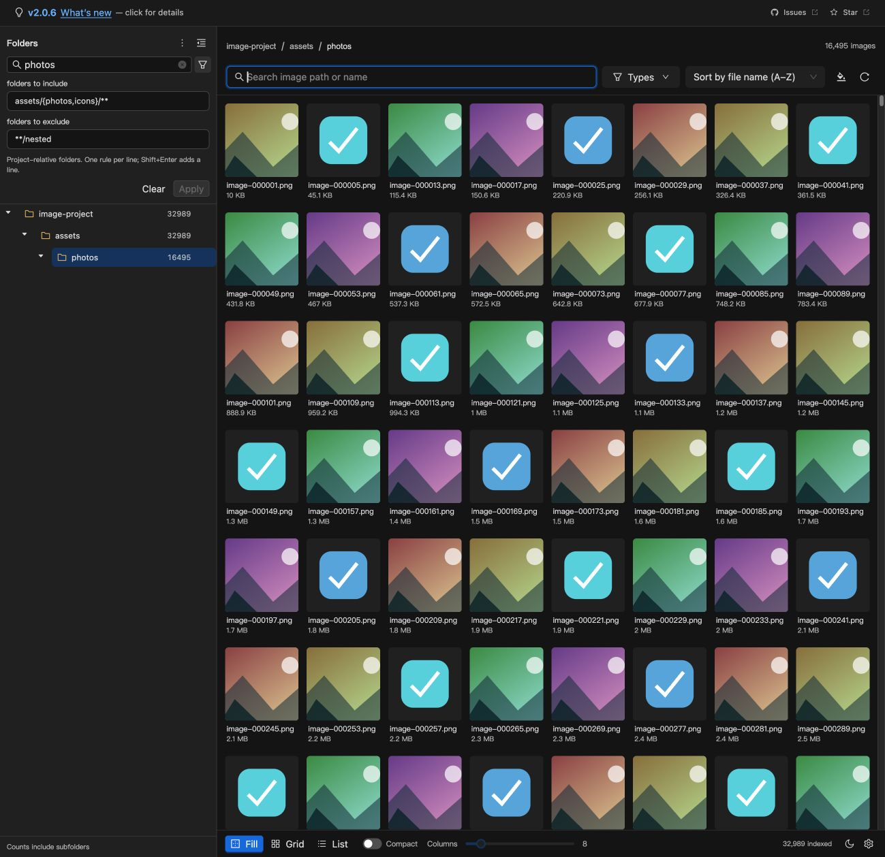

# Image Viewer

**English** | [中文](./README.zh-CN.md)

View individual images or browse a folder as a gallery in **VS Code and Cursor**. Inspect details with zoom, pan, rotation, flip, and a navigation minimap; find project assets with thumbnails, search, sorting, and filters.

## Quick start

| To… | Do this |
| --- | --- |
| Open an image | Right-click an image in Explorer → **Open With...** / **Reopen Editor With...** → **Image Viewer** |
| Use Image Viewer by default | Open the Command Palette (`Ctrl+Shift+P` / `⌘⇧P`) → **Image Viewer: Use as Default Image Editor** |
| Browse the workspace | Open a folder or workspace → run **View Images 🌄** from the Command Palette |
| Browse a specific folder | Right-click the folder in Explorer → **View Images 🌄**; includes its subfolders |

## Single-image viewer

Open an image directly in a full-screen preview within the editor tab, with controls that fade when idle.

- **Zoom:** use the mouse wheel, toolbar buttons, or enter a percentage. Press **Space** or click the main image for an adaptive Fit → Detail → 100% cycle (two states when Detail adds little; small images use Fit/100% → 200%). Drag after zooming to pan. Presets extend through 250%, 300%, 400%, 600%, and 800%.
- **Inspect details:** drag an enlarged image or use the minimap to move around it.
- **Rotate and flip:** rotate in either direction or flip horizontally and vertically. These view changes do not modify the file.
- **Navigate:** use the toolbar or side arrows to view other images in the same folder. The order follows Explorer's sorting settings, including reverse order.
- **Keyboard controls:** zoom, switch zoom modes, rotate, and navigate from the keyboard.

The single-image editor is read-only. It lists images in the opened file's immediate folder, without scanning subfolders or loading the gallery interface. It uses original images directly, without generating thumbnails, and also works for files outside the workspace.

<!-- Screenshot TODO: assets/screenshots/single-image-editor.png.
Capture a dark-theme editor window with Explorer, the selected image tab, an enlarged image,
the minimap, and the visible toolbar (filename, zoom, rotate, flip, and navigation).
Add the Markdown image only after the file exists.
-->

### Make it the default

Run **Image Viewer: Use as Default Image Editor** to open supported image files with this viewer by default. Installing or updating the extension leaves your editor choice unchanged.

To remove these associations, run **Image Viewer: Restore VS Code's Default Image Editor**. VS Code then uses its normal editor selection; this does not restore a previous custom association overwritten by the setup command.

Both commands update the global User `workbench.editorAssociations` setting. Workspace and Workspace Folder settings can override it. The restore command removes only supported image associations that still point to Image Viewer, preserving unrelated or subsequently changed associations. Run it before uninstalling if you want to remove those global associations.

<!-- Screenshot TODO: assets/screenshots/set-default-image-editor.png.
Capture the Command Palette with “Image Viewer: Use as Default Image Editor” highlighted.
Use the same theme as the single-image screenshot; add the Markdown image only once captured.
-->

## Workspace gallery

Use the Folders sidebar to select a directory, then browse its images in one continuous thumbnail wall. Click a thumbnail to open the large-image preview.

- **Folders tree:** show direct or recursive image counts, search directories, expand or collapse branches, hide the sidebar, and drag its edge to resize. Toggle **Include subfolders** from the Folders menu. Expand the filter button beside **Find folder** to edit directory scan rules. Right-click a folder to reveal it, copy its path, expand/collapse its subtree, or exclude it from scanning.
- **Fill / Grid / List:** Fill crops thumbnails to square cells; Grid shows the entire image; List adds file paths, sizes, original dimensions, and modified times. Drag the bottom-bar thumbnail slider right for larger images, with live pixel sizes (1–20 columns in Fill/Grid).
- **Compact mode:** remove gaps and persistent captions in Fill/Grid, or reduce List spacing. Image menus remain available.
- **Scroll position:** drag the gallery scrollbar to see the folders in view and reveal/highlight them in the Folders tree without changing your selected directory. Wheel scrolling does not drive this indication.
- **Large collections:** the wall and tree use virtual scrolling. Thumbnail requests prioritize visible images, cap concurrency, and discard unused results beyond a small bounded cache.
- **Search, filter, and sort:** search by file name/path, filter by type, and toggle subfolders. Sorting defaults to folders first, then name within each folder; choose name, modified time, size, or format in either folder-first or global mode. Preview follows the same order. Scrollbar folder hints and tree highlighting are available in folder-first mode.
- **Image menu:** reveal an image, browse its folder, copy paths/name/Base64, or **Move to Trash** after confirmation.
- **Settings and feedback:** use the bottom-right gear for file-size display and GitHub issue/email feedback. Theme and image background controls stay on the gallery.
- **Appearance and folder tabs:** Follow inherits the current editor colors; manual Light/Dark use VS Code Light 2026 / Dark 2026 snapshots. Image background choices start with a frameless **No background** option, followed by checkerboard and solid colors. Supports separate gallery tabs for Explorer folder selections.

### Directory rules

Folder search and scan filters work together. Expand the filter icon beside **Find folder**, enter one project-relative directory rule per line, then press Enter or **Apply**. Shift+Enter adds a line. Collapsing the fields keeps applied rules active.

| Rule | Meaning |
| --- | --- |
| `assets` or `assets/**` | assets and its entire directory tree |
| `assets/{photos,icons}/**` | both directory trees |
| `**/test-*` | matching directories at any depth and their descendants |
| `**/{dist,build}` | dist/build directories at any depth and their descendants |

Include and exclude compose; exclude wins. Empty include scans the current entry's full range. Explorer folder entries intersect include rules. Directory rules use Glob rather than regex and match directories; use **Types** to filter image formats. Invalid rules show an error without being applied.

### Screenshot

Development preview with generated Mock images:

## Image formats

Recognized file extensions: `SVG`, `PNG`, `JPEG`, `JPG`, `ICO`, `GIF`, `WebP`, `BMP`, `TIF`, `TIFF`, `APNG`, `AVIF`.

Rendering depends on the embedded browser in VS Code or Cursor; recognizing an extension does not guarantee that every encoding can be displayed.

## Disk cache

VS Code and Cursor may cache full copies of images loaded in a WebView (an embedded browser view). Image Viewer cleans old image resource caches in the background after the initial render and a browser idle window. During use, it prunes resources no longer used by open panels, with a short grace period for navigation.

The gallery and single-image editor have separate cache scopes. Open each viewer after upgrading to clean its accessible historical cache. Closing the last panel in a scope attempts to clear it; crash or forced-exit residue is cleaned on the next opening if the host reuses that scope. The gallery's thumbnail disk cache is separate from these resource caches. It is checked shortly after opening and every two minutes: above 500 MiB or 25,000 files, older entries are removed toward 85% of both limits. These are background soft limits, so brief overshoots are possible while thumbnails are generated.

For immediate gallery cleanup, run **Image Viewer: Clean Gallery WebView Image Cache**. This command does not clean the single-image editor's cache. Old cache scopes abandoned by the host cannot be reached by the extension and may need manual cleanup while VS Code or Cursor is closed.

## Development preview

Run `yarn ui-dev`, then open `http://127.0.0.1:5000/?mock=1`. Add `&count=100000&folders=1000` to test a large collection. Mock mode uses generated SVG images and isolated browser settings; file actions do not affect real files. It is available only in development browser builds. Use F5 → **Run Extension** to check real workspace images and host interactions.

## Feedback

- [Changelog](./CHANGELOG.md)
- [Report a bug or request a feature](https://github.com/ZhangJian1713/vscode-image-viewer/issues)
- Contact: zhangjian1713@gmail.com
